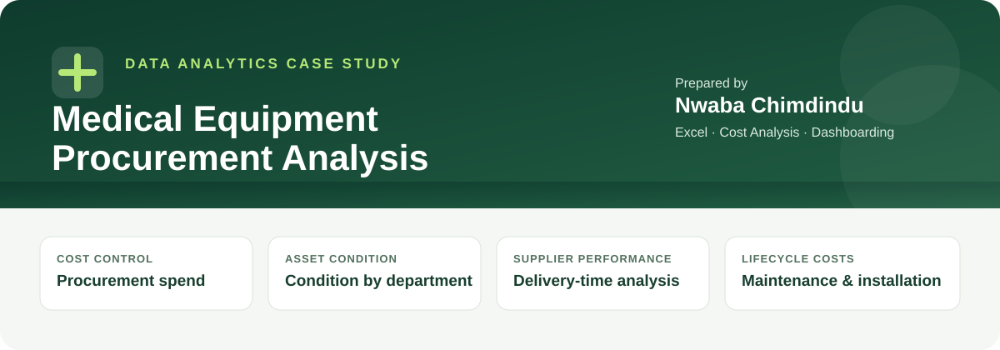
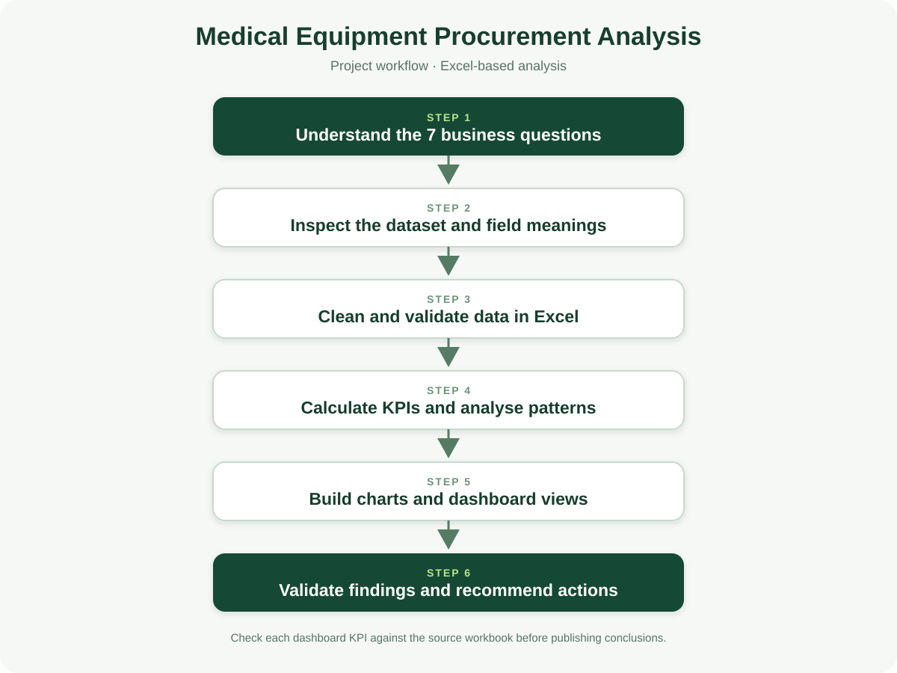

# Medical Equipment Procurement Analysis

  

**Prepared by:** Nwaba Chimdindu  
**Tools:** Microsoft Excel · PivotTables · Dashboarding  
**Focus:** Procurement spending, equipment condition, supplier performance, and lifecycle costs

---

## Project Overview

Hospitals need dependable medical equipment, timely deliveries, and clear visibility into procurement and lifecycle costs. This project analyses a dataset of hospital equipment purchases, supplier details, delivery dates, equipment condition, maintenance, warranty, and installation costs.

The work translates seven business questions from the project brief into descriptive analysis intended to help procurement teams compare spending patterns, review equipment condition, and examine supplier and delivery performance.

## Business Questions

1. Which hospitals have the highest equipment procurement values?
2. How is equipment condition distributed across departments?
3. How do annual maintenance costs vary by equipment type?
4. How do delivery times compare across suppliers?
5. Which states account for the highest installation costs?
6. How are suppliers distributed by country?
7. How does equipment condition relate to installation costs?

## Dataset

The source workbook contains **260 records and 19 named fields**. The public-use workbook excludes supplier contact names, phone numbers, and email addresses.

| Field group | Included fields |
|---|---|
| Hospital and location | Hospital, State, Location, Department |
| Equipment | Equipment, Quantity, Equipment Condition, Warranty Period |
| Cost | Unit Price, Maintenance Cost, Installation Cost |
| Supplier | Supplier, Supplier Country |
| Dates | Date Ordered, Date Delivered |

**Project files:** [Download the sanitized dataset](https://github.com/dinduanalytics/medical-equipment-procurement-analysis/releases/download/v1.0.0/procurement_dataset_sanitized.xlsx) · [View the project brief](docs/project-brief.md) · [Read the data dictionary](docs/data-dictionary.md)

## Analytical Workflow

The workflow moves from business questions and data inspection through preparation, metric definition, comparative analysis, and dashboard communication. Delivery time is derived from the difference between delivery and order dates. Cost comparisons are interpreted according to the field and calculation being used.

## Dashboard

[Open or download the dashboard screenshot](https://github.com/dinduanalytics/medical-equipment-procurement-analysis/releases/download/v1.0.0/medical-procurement-dashboard.jpg) · [View release assets](https://github.com/dinduanalytics/medical-equipment-procurement-analysis/releases/tag/v1.0.0)

## Key Observations

- The dataset contains **92 distinct hospital names**, **35 state values**, **40 supplier names**, and **15 supplier-country values**.
- Equipment condition counts are **New (124)**, **Used - Good (88)**, **Refurbished (40)**, and **Used - Fair (8)**.
- Delivery time ranges from **23 to 29 days**, with a mean of approximately **25.30 days**.
- Using the specific calculation **Quantity × Unit Price**, the largest hospital totals include Minna Federal Medical Center (**$1,815,000**), Yenagoa Medical Center (**$1,434,000**), and Dutse General Hospital (**$1,335,000**).

These are descriptive findings from the supplied source workbook. They identify patterns for review but do not establish the reasons behind them.

## Metric Definitions and Interpretation

The supplied dashboard displays total procurement cost of **$21,639,000**, average delivery time of **25 days**, annual maintenance cost of **$461,400**, installation cost of **$275,100**, and average unit price of **$37,519**.

Calculations from the current source worksheet produce **$20,910,500** for the sum of Quantity × Unit Price, **$462,600** for maintenance cost, **$275,700** for installation cost, and **$37,405** for average unit price. The mean delivery time is **25.30 days**, consistent with a dashboard display rounded to 25 days.

The dashboard figures are reported as shown in the supplied screenshot; the calculated values are reported separately using the source fields and stated calculation. Procurement totals can differ depending on the business definition and formula used. See [Metric Definitions and Source Comparison](docs/data-quality-and-reconciliation.md) for calculation details.

## Business Applications

The analysis can help frame discussions about:
- Hospitals and states with comparatively high recorded procurement values.
- Departments with larger shares of used or refurbished equipment.
- Equipment types with higher annual maintenance costs.
- Differences in supplier delivery times.
- Supplier-country distribution and sourcing concentration.
- Installation costs across equipment condition groups.

These comparisons are most useful when considered alongside equipment type, quantity, and the relevant cost definition; descriptive patterns alone should not be treated as proof of causation.

## Repository Guide

| Path | Purpose |
|---|---|
| README.md | Project case study and key observations |
| dashboard/ | Project visuals and dashboard documentation |
| data/ | Public-data documentation |
| docs/project-brief.md | Business questions and source field descriptions |
| docs/data-dictionary.md | Field definitions and privacy notes |
| docs/data-quality-and-reconciliation.md | Metric definitions and source comparisons |
| docs/analysis-workflow.svg | Analysis workflow diagram |
| scripts/sanitize_dataset.py | Creates a public-safe workbook copy |
| analysis/README.md | Calculation and interpretation notes |

## Data Privacy and Scope

The original workbook includes supplier contact details. The public-use workbook excludes supplier contact names, phone numbers, and email addresses. The analysis is descriptive and depends on the completeness and definitions of the supplied fields.

---

*An Excel-based procurement analysis focused on transparent metrics, comparative insights, and practical decision support.*
